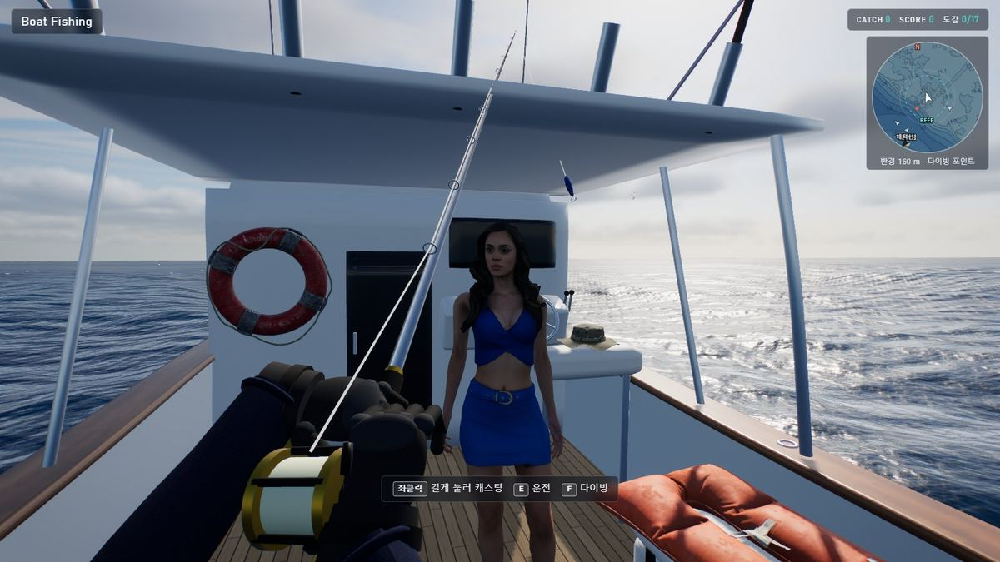
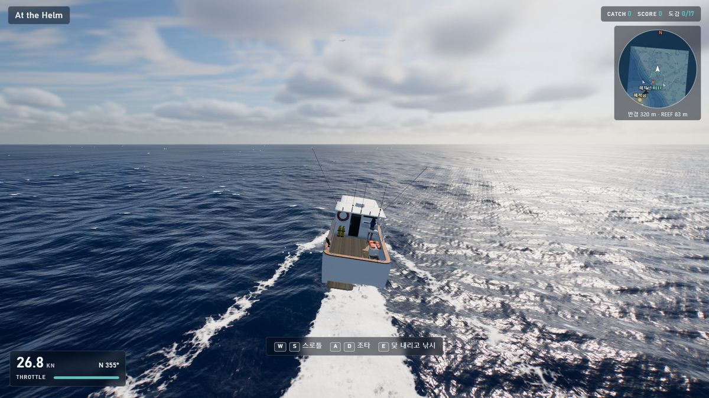
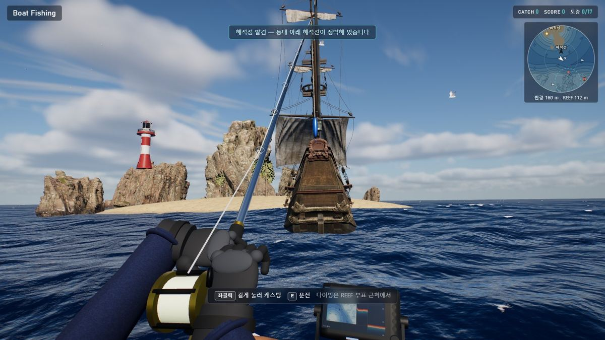
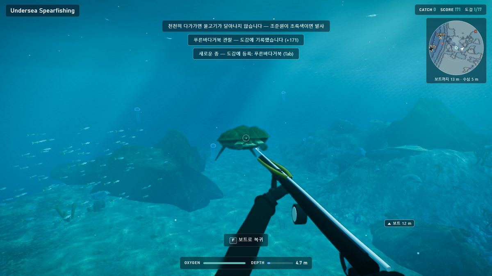

# Project Deep Blue

크롬에서 바로 실행되는 **풀 3D 선상 낚시 · 보트 운전 · 해저 작살** 게임입니다. 설치·빌드·서버 없이 브라우저만 있으면 됩니다.

### ▶ [지금 플레이하기](https://leepillwoo.github.io/Project-DeepBlue/)

데스크톱 Chrome, 키보드와 마우스 기준입니다. 처음 접속 때 약 40 MB를 받고, 로딩은 10~15초쯤 걸립니다.

| 선상 낚시 | 보트 운전 |
|---|---|
|  |  |
| **해적섬과 범선** | **해저 작살·관찰** |
|  |  |

## 주요 기능

- **낚시**: 타이밍 캐스팅(백래시 있음), 간 보는 입질, 낚싯대로 하는 줄다리기(펌핑·완충·측면 압박), 줄이 끊긴 대어를 다이빙해서 추적
- **운전**: 선체 5개 지점의 부력을 파도에서 직접 계산 — 맞파도에서는 뜨고 떨어지며 물보라
- **작살**: 2차 항력 탄도, 조준 보정, 물고기·상어·해파리 AI, 문어와 바다거북, 채집물과 보물상자
- **바다 생물**: 범고래 무리·향유고래·흰수염고래가 보트 옆과 물속을 지나가고, 혹등고래가 보트 곁에서 솟구칩니다. 리프에는 고래상어·만타가오리·귀상어 떼·백상아리·파자마상어·나뭇잎해룡·청게·갯민숭달팽이·숭어 떼
- **바다**: 해적섬·등대·범선, 어부가 탄 어선, 트롤선, 갈매기, 미니맵
- **날씨**: 몇 분마다 폭풍이 수평선에서 몰려와 지나갑니다 — 먹구름, 폭우, 낙뢰와 늦게 도착하는 천둥, 거칠어지는 바다. 폭풍 속에서만 무는 대물(황새치·GT·돗돔)이 있습니다
- **이벤트**: 보물 지도가 든 유리병, 안개 속 유령선, 먼바다의 바다뱀, 대포를 쏘며 쫓아오는 해적선, 조명탄으로 물리치는 크라켄
- **도감**: 36종, 종별 기록과 찾는 법 힌트 (브라우저에 저장)
- **사운드**: 효과음 43종과 빗소리·바람까지 전부 WebAudio 합성(샘플 파일 없음)

## 로컬에서 실행

저장소를 받아 `index.html`을 Chrome으로 더블클릭하면 됩니다. 오프라인에서도 동작합니다.

GitHub Pages(위 링크)는 `main` 브랜치를 그대로 띄우므로, 푸시하면 1~2분 안에 반영됩니다.

기획서 원본은 `docs/gemini-code-1794302900744.html`에 있습니다.

## 조작

| 모드 | 키 |
|---|---|
| 공통 | 마우스 = 시점, `Tab` = 도감(열려 있는 동안 게임 정지, `↑↓` 스크롤), `Esc` = 일시정지 |
| 선상 낚시 | `좌클릭` 길게 눌렀다 놓기 = 캐스팅 / 누르는 동안 = 릴링, 파이팅 중 `마우스 앞뒤` = 낚싯대 내리기·세우기, `우클릭` = 줌, `E` = 운전, `F` = 다이빙(REEF 부표 근처에서만), `T` = 시간대, `R` = 폭풍 부르기·보내기 |
| 운전 | `W`/`S` 스로틀 전진·후진, `A`/`D` 조타, 마우스 = 추적 카메라 회전, `E` = 엔진을 끄고 닻을 내린 뒤 낚시 위치로 |
| 해저 작살 | `WASD` 유영, `Space`/`C` 상승·하강, `Shift` 질주, `좌클릭` 발사, `우클릭` 조준, `E` 채집·줍기, `L` 라이트, `F` 보트로 복귀(어디서든) |

- **캐스팅**: 버튼을 누르고 있으면 낚싯대가 뒤로 휘며 게이지가 찹니다. **초록 칸**에서 놓으면 비거리 +10%에 방향도 정확합니다. 더 오래 쥐고 있으면 빨강(과부하)으로 넘어가 **백래시** — 루어가 코앞에 떨어지고 2.6초 동안 줄을 풀어야 합니다. 그보다 더 쥐고 있으면 힘이 빠졌다가 다시 찹니다. 놓는 순간 마우스를 앞으로 밀면 조금 더 나갑니다.
- **입질**: 물고기가 먼저 루어를 톡톡 건드립니다(그때 챔질하면 놀라 달아남). 확 끌고 가는 순간 **새로** 좌클릭해야 걸리고, 버튼을 계속 누르고 있으면 걸리지 않습니다. 기다리는 동안 좌클릭을 짧게 끊어 치면 입질이 빨라집니다.
- **낚싯대 줄다리기**: 물고기가 걸리면 마우스 앞뒤가 시점 대신 낚싯대를 움직입니다(HUD의 ROD 게이지).
  - *펌핑* — 마우스를 당겨 낚싯대를 세우면 물고기가 끌려오고, 밀어 내리면서 감아야 그 줄이 내 것이 됩니다. 낚싯대를 가만히 둔 채 감기만 하면 줄이 45%밖에 안 감깁니다(같은 시간에 펌핑이 약 3배).
  - *완충* — 낚싯대를 세워 두면(게이지의 표시 구간) 휘면서 충격을 받아 줍니다. 물고기 쪽으로 눕히거나 끝까지 젖히면 텐션이 최대 1.4배까지 올라갑니다.
  - *측면 압박* — 물고기가 도는 반대쪽으로 시점을 돌려 낚싯대를 눕히면 방향을 틀게 하고 더 빨리 지치게 합니다.
  - 질주 중에 낚싯대를 확 당기거나 감으면 텐션이 치솟습니다. 낚싯대를 세운 채 버티세요.
- **파이팅**: 물고기가 질주하면 릴을 놓고(드랙), 버티기·점프·지침 상태에서는 감습니다. 줄이 끊어지면 14초 안에 `F`로 뛰어들어 지친 대어를 작살로 마무리할 수 있습니다.
- **작살**: 천천히 다가가면 물고기가 달아나지 않습니다. 조준원이 **연두색**으로 바뀌면(이름·거리 표시) 그 물고기의 이동 방향까지 계산해 맞춰 줍니다. 바위나 지형에 가려 있으면 조준이 잡히지 않습니다.
- **운전**: 선체 5개 지점의 부력을 파도 높이에서 직접 계산합니다. 속도가 붙으면 활주하면서 선체가 뜨고, 맞파도(섬 방향)에서는 파도를 넘다 떨어지며 물보라가 터집니다. 뒷파도에서는 파도를 타고 가속됩니다.
- **폭풍**: 출항 후 5분쯤부터 4~8분 간격으로 옵니다(`R` 로 바로 부르거나 보낼 수 있습니다). 50초에 걸쳐 구름이 덮이고 어두워지며, 2~4분 동안 폭우와 낙뢰가 이어진 뒤 걷힙니다. 파도가 약 1.9배 높아져 보트가 크게 흔들리고, 먼 섬과 배는 빗속에 흐려집니다. 번개는 거리에 따라 천둥이 늦게 들립니다. 이때 깊은 수심에서는 **황새치**, 리프에서는 **자이언트 트레발리**, 어디서든 **돗돔**이 뭅니다 — 맑은 날 어종보다 힘과 지구력이 높습니다. 물속도 어두워집니다.
- **미니맵**(우상단): 보트·REEF(다이빙 포인트)·해적섬·해적선·다른 배. 다이빙 중에는 내 위치 기준으로 돌아가고, 보트가 범위 밖이면 가장자리에 방향이 표시됩니다. 화면에도 `▲ 보트 N m` 표식이 따라다닙니다.

## 바다에 있는 것들

- **해적섬**(시작 지점에서 남서쪽 약 260 m): Megascans 해안 절벽 + 모래톱·야자수·해적기·보물상자, 등대, 정박한 범선(Poly Haven 난파선 모델에 돛을 올린 것)
- **다른 배**: 낚시 중인 어선 2척(어부 캐릭터 탑승), 큰 원을 그리며 지나가는 트롤선. 부딪히면 밀려납니다.
- **크루**: 갑판에서 대기하다가 낚시에 성공하면 춤을 추고, 운전 모드에서는 타륜을 잡습니다(손 위치는 IK).
- **수중**: 문어(먹물을 뿜고 두 번 달아난 뒤 지침 → 작살 또는 `E`), 바다거북(보호종 — 다가가면 관찰 기록), 성게·거미고둥·불가사리(`E` 채집), 난파선 옆 보물상자
- **더 만나는 것들**: 파자마상어·나뭇잎해룡(다가가면 관찰 기록), 갯민숭달팽이(`E` 관찰), 청게(서두르면 옆걸음으로 달아남 — 천천히 다가가 `E`), 수면 아래 숭어 떼(작살)
- **위험**: 흉상어 두 마리에 더해, 오래 잠수하거나 피를 많이 흘리면 백상아리가 옵니다(작살 두 발). 상어가 가까워질수록 화면 가장자리가 붉어지고, 돌진할 때는 빠르게 깜박입니다. 해파리 곁에서도 붉어집니다.
- **리프의 거인들**: 고래상어(약 11 m)가 리프 위를 느릿느릿 돌고, 만타가오리 두 마리가 날갯짓하며 활공합니다. 고래상어는 통과할 수 없는 몸입니다. 귀상어 일곱 마리가 난파선 주위를 도는데, 곁에 5초 넘게 머물면 한 마리가 덤벼듭니다.
- **지나가는 큰 동물**: 범고래 무리, 향유고래, 흰수염고래(24 m), 혹등고래가 1~2분 간격으로 번갈아 지나갑니다. 보트에서는 등지느러미·물기둥이, 물속에서는 리프 바깥쪽으로 온몸이 보입니다. 혹등고래는 가장 가까워지는 지점에서 수면 위로 솟구쳤다가 옆으로 떨어집니다.
- **이벤트**(2~4분 간격으로 하나씩, 물고기와 싸우는 중에는 시작하지 않음):
  - *유리병* — 근처에 병이 떠다닙니다(화면 표식과 미니맵의 "병"). 보트를 몰아 7 m 안으로 가면 건져 올리고, 안의 지도가 미니맵에 ✕를 찍습니다. 그 자리로 다이빙해 반쯤 묻힌 상자를 `E`로 파내면 3,500점.
  - *유령선* — 하늘이 흐려지고 안개가 끼면서, 해골 선원을 태운 초록빛 범선이 40~60 m 옆을 미끄러져 지나갑니다. 폭풍이나 석양에 더 자주 나옵니다.
  - *바다뱀* — 115~165 m 밖에서 목과 등 마디를 드러내고 30초쯤 헤엄치다 가라앉습니다.
  - *해적선* — 붉은 돛의 배가 8.5 m/s로 쫓아와 200 m 안에서 대포를 쏩니다. 포탄은 물기둥을 올리고, 4.5 m 안에 떨어지면 피격(−300점)입니다. 보트는 최고 14 m/s이므로 `E`로 엔진을 켜고 달아나면 됩니다 — 320 m 이상 벌리면 포기합니다(+1,500점, 맞았으면 +800점). 가만히 있으면 70 m 밖에서 돌며 계속 쏩니다.
  - *크라켄* — 닻을 내리고 있을 때만. 촉수 여섯 개가 보트를 에워싸고 하나씩 몸을 젖혔다 내리칩니다(한 번에 −200점, 다섯 번이면 −1,000점을 더 잃고 끝). 낚싯대 대신 쥐여지는 조명탄 권총을 `좌클릭`으로 쏴 촉수를 맞히면 가라앉습니다. 여섯 개를 모두 쫓아내면 +2,500점(맞은 횟수 × 300점 차감). 이 동안에는 운전·다이빙을 할 수 없습니다.
- **도감**: 36종. 낚시·작살·채집·관찰로 등록되며 종별 기록과 찾는 법 힌트가 나옵니다. 저장은 브라우저 `localStorage`.

## 구조

```
index.html              진입점 + HUD(DOM/CSS)
lib/three.min.js        three.js r160 (MIT)
assets/                 에셋 팩(생성물) — manifest.js 가 불러올 팩 목록
src/engine/             core(수학·지오메트리·입력) · assets(팩 로더·스키닝 캐릭터) · post(HDR·블룸·톤매핑) · fx(파티클) · audio(합성 사운드)
src/world/              env(하늘·구름) · ocean(파도) · world(해저 지형 함수) · reef(수중 머티리얼·산호초·난파선) · sea(섬·등대·다른 배·갈매기) · weather(폭풍·비·낙뢰)
src/game/               boat(보트·부력·운전) · fish(어종 표·물고기) · fishing · dive(작살·AI·채집·문어·거북) · wild(지나가는 범고래·고래, 혹등고래 브리칭) · events(유리병·유령선·바다뱀·해적선·크라켄) · crew · dex(도감) · ui(HUD·미니맵) · main(상태 머신·카메라)
tools/                  개발용 — 게임 실행에는 필요 없음
  assets.config.mjs       어떤 모델이 어느 팩에 들어가는지
  build_assets.mjs        팩 생성 + CREDITS.md 생성
  blender_prep.py         무거운 GLB 데시메이트 (Blender CLI)
  fab/                    Fab 무료 에셋 검색·다운로드 (로그인된 크롬 사용)
  dev/                    헤드리스 검증 하네스, GLB 뷰어, 팩 뷰어
  build_demo.mjs          claude.ai Artifact 용 데모 페이지(demo/) 생성 — GitHub Pages 에는 필요 없음
raw/fab, raw/prep       원본·중간 GLB (게임 실행에는 필요 없음, 약 1.2 GB — 지워도 됩니다)
docs/                   기획서 원본
```

스크립트는 ES 모듈이 아니라 전역 `DB` 네임스페이스를 공유하는 일반 `<script>` 입니다. `file://` 에서는 모듈·`fetch` 가 막히기 때문입니다. 같은 이유로 모델·텍스처도 JS 파일(`assets/*.js`)에 base64 로 들어 있습니다.

## 에셋 추가하기

1. **찾기** — `cd tools/fab && node fabfind.mjs boats "fishing boat" "trawler"` → `out/fab_boats.jpg` 번호표와 라이선스·uid 목록
2. **받기** — `node fabget.mjs ../../raw/fab <uid> <uid> …` → `raw/fab/*.glb`, 출처는 `raw/fab/credits.json` 에 기록
3. **줄이기**(수십만 폴리곤일 때) — `blender -b --python tools/blender_prep.py -- raw/fab/x.glb raw/prep/x.glb 30000`
4. **등록** — `tools/assets.config.mjs` 에 한 줄 추가 (`glb:` 또는 `prep:`, 텍스처 크기, 넣을 팩)
5. **빌드** — `cd tools && npm i && node build_assets.mjs sea` (인자 없으면 전체) → `assets/sea.js`, `assets/manifest.js`, `CREDITS.md`
6. 코드에서는 `DB.Assets.object('이름')`(정적 모델) 또는 `DB.Assets.character('이름')`(스키닝 + 애니메이션)

Fab 스크립트는 `chrome.exe --remote-debugging-port=9333 --user-data-dir=%LOCALAPPDATA%\DeepBlue-FabProfile` 로 띄워 직접 로그인해 둔 크롬에 붙습니다. "Download" 버튼만 누릅니다. 등급을 골라야 하는 에셋("Select a License")은 `PERSONAL=1 node fabget.mjs …` 일 때만, 그리고 메뉴에 Personal 등급이 Free 로 표시될 때만 그 등급을 골라 받습니다(연 매출 10만 달러 이하 개인·소규모 팀용). 결제 단계로 넘어가는 일은 없습니다.

FBX·.blend 만 있는 에셋은 `blender_prep.py` 가 GLB 로 바꿔 줍니다. 텍스처가 없는 스컬프트는 `build_assets.mjs` 의 `PAINT`(버텍스 컬러), 흰 배경에 그린 아틀라스의 이음새는 `bleed: true` 로 처리합니다.

캐릭터 애니메이션은 같은 Mixamo 리그끼리 리타게팅됩니다(`assets.config.mjs` 의 `clips: [{ from: '다른.glb', anim: 'idle' }]`).

## 검증

- `index.html?selftest` — 캐스팅 타이밍, 입질 규칙, 낚시 파이팅과 낚싯대 조작(펌핑·완충), 작살 사거리, 운전(최고 속도·조타·섬 충돌·정박), 조준 보정 명중, 위험 비네팅, 게의 도주, 고래상어 충돌, 범고래 통과와 도감 등록, 혹등고래 브리칭, 폭풍(파도·비·낙뢰·전용 어종·원상 복귀), 이벤트 5종(해적선 포격과 도주, 크라켄 격퇴, 유령선·바다뱀 목격, 보물 지도), 도감 사진, 전체 효과음 렌더링을 자동 점검하고 콘솔에 PASS/FAIL 을 찍습니다.
- `tools/dev/shot.mjs` — 실제 GPU 로 헤드리스 크롬을 돌려 스크린샷을 찍습니다. `DB.debug.*`(`drive`, `tp`, `dive`, `key`, `view` …)로 상태를 만들 수 있습니다.

## URL 옵션

- `?q=low|medium|high|ultra` 품질 (기본 high, 프레임이 떨어지면 해상도를 자동으로 낮춤)
- `?tod=day|golden|morning` 시작 시간대
- `?autostart` 타이틀 건너뛰기, `?selftest` 자가 검증, `?noweather` 폭풍이 저절로 오지 않게(`R` 로는 부를 수 있음), `?noevents` 이벤트가 저절로 일어나지 않게

## 에셋 출처

전체 목록은 [CREDITS.md](CREDITS.md) (빌드 스크립트가 생성).

- **Fab — Quixel Megascans** (Fab Standard License): 산호·바위·해안 절벽·나무 보트·술통
- **Fab — CC-BY 4.0** (출처 표기 필수): 크루 캐릭터 *Rumba Dancing* — Dom Baker / 대기·걷기 애니메이션 *Thailand Girl* — Tony Flanagan / 어선·어부 — Charlie catling / 트롤선 — Romain Ferre / 등대 — DylanHayes / 야자수 — UPWARD / 보물상자 — GG Beta Pie / 바다거북 — Forge of Fantasy / 참치 — GoldenZtuff / 상어 — Optic Idealist
- **Fab — Standard License 무료 등급**: 범고래·향유고래 — 5puj47980xk / 청게 — Kirene / 갯민숭달팽이 — Nestaeric / 파자마상어 — Nyi Nyi Tun / 백상아리 — Agher / 숭어 — Oliver Cooke, **CC-BY**: 나뭇잎해룡 — JuanG3D
- **Poly Haven** (CC0): 이끼 바위, 범선, 소품, 해저 텍스처
- **CC-BY**: 혹등고래 *Free Stylized Whales* — LapaModels (채도를 낮춰 사용) / 유령선의 해골 *Human Skeleton* — Salt Lake Manor
- 보트·낚싯대·작살총·문어·성게와 나머지 물고기, 고래상어·흰수염고래·귀상어·만타가오리·황새치·GT·돗돔, 모든 효과음은 코드로 생성합니다.
